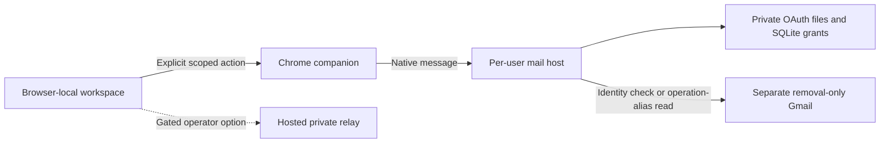

# Erase Me architecture and data contracts

## One-session local setup and additional form contracts (0.12.0)

`mail_setup_web.py` serves an explicit allowlist on random-port loopback. It uses a
fragment bearer, strict Host/Origin and bounded request schema, with no CORS or cookies.
The browser sends a selected Desktop client only to that local process; a private
temporary file feeds the existing setup guide. Account identity and existing scope
checks are reused. Close/expiry and installation reservation share a lock; no recurring
service or mail check is installed. A shared Google client still needs provider approval.

SmartBackgroundChecks has a privacy-entry gate before normal BASE/AUTO execution.
The journal precedes public navigation, the published link is checked in the original
document, and profile data is withheld until the canonical form passes inspection.
CMA uses a separate transient address schema/dialog and marketing-registration
contract; it cannot enter ordinary batches or increment deletion/request counters.

FamilyTreeNow adds the tenth guarded broker initial contract. MyLife, PeopleFinders
and That’s Them use separate transient private reviews and exact observed form
contracts. They cannot enter generic form payloads or batches. Extra identity fields
never enter saved workspace state, backups or companion outcome journals; challenge
and submission remain manual. The catalog now has fourteen standard and five
transient form actions, including CMA’s separate marketing registration.

Optional outbound privacy email is isolated in `tools/removal_sender.py` and the
`send-contract.js` protocol. Old read-only OAuth configurations stay valid. Explicit
setup consent may add exactly `gmail.send`; a same-account upgrade still requires
fresh consent. Seven immutable, purpose-verified recipient/source pairs constrain
the sender. Support contacts and record-associated sender channels are excluded.

The workspace reserves a profile-bound preview under its cross-tab Web Lock before
native preparation. A digest binds the in-memory record reference and exact message;
only opaque operation/capability references persist. Final approval reserves sending
before native dispatch. The native SQLite outbox durably records `started` before
Google’s fixed send API is called. Ambiguous results have no retry path. Native
revocation creates a tombstone before late preparation can bind; imports cannot
reactivate a grant. Holds and campaign pause are checked under the same writer lock.
Message bodies and typed record references are not stored in the local outbox or
workspace. Google message/thread IDs establish provider API acceptance only, with
delivery, broker acceptance and deletion explicitly false.

## Guided setup and transient initial identity fields (0.11.0)

`tools/setup_removal_mail.py` composes the existing installed OAuth and native-host
interfaces into one explicit local guide. It preflights local registration, verifies
a saved account before reuse and keeps credentials outside browser storage and source
downloads. The popup constructs its command from a validated public extension ID.

People Trace UK uses an independent `peopletrace-prefill-v1` contract and dialog.
`preparePeopleTrace` reserves under the workspace write lock; private details travel
only in the returned payload, not the ledger. `fill-peopletrace` validates an exact
schema, journals before navigation and injects into the pinned official document.
The normal batch and generic executor cannot dispatch this special manual route.
Only fixed prefill outcomes are persisted. Challenge and submission stay manual.

USPhonebook is the eighth guarded initial submit contract; AUTO v6 and its new
capability gate preserve compatibility with earlier form-only companions.

## Per-user mail transport (0.10.0)

The public browser workspace supports a per-user native Gmail connector after explicit
desktop setup. The hosted shared-mail pilot retains its operator gate. The two transports
have separate capability issuers and cannot consume one another's contacts.



The native host pins the installed extension origin and dedicated Google identity,
excludes the configured primary account, and binds grants to a workspace and operation.
Local quotas, leases, consumed continuations and revocation are durable. No expiry job
or polling loop is installed; time-based limits are evaluated during explicit calls.
OAuth credentials, raw mail and private confirmation URLs never enter the workspace
backup. Scoped contact capabilities remain private backup data; restored native contacts
are inactive history and cannot silently rebind to a replacement workspace.

Holds and cleanup closure persist under the binding lock before native revocation. Late
issuance revalidates its original approval and revokes under the original scope if that
context changed; an exact already-bound, unheld grant remains valid during a campaign
pause. Uncertain cleanup leaves a closed setup tombstone. Public users need their own separate account, installed OAuth
client and supported native host; no automatic mailbox provisioning is claimed. See
[setup](LOCAL_REMOVAL_MAIL.md) and the [stage matrix](INTEGRATION_STATUS.md).

SearchPeopleFree adds the sixth guarded initial contract with exact own-email consent,
genuine Turnstile response and a new minimum companion capability. Its user-owned local
contact is permitted, while shared operator contacts remain prohibited. Its confirmation
links remain held pending an observed destination contract.

Apollo adds the seventh guarded initial contract for an explicitly affirmed business
email. A companion-owned `form-action 'none'` CSP prevents its default GET fallback
from disclosing the address in a URL; the normal site's prevented-default request can
still run. A checked event remains an attempt, not receipt or deletion evidence.

This document describes the original agent-skill engine and reference-pack contracts.
The live browser workspace uses separate storage and permissions; see
[its current scope and interface](PUBLIC_WORKSPACE.md). Its 43 reference routes do not
imply 43 automated integrations or a verified removal service. The eleven initial companion
actions include separately affirmed Apollo business-email, Spokeo listing fields and five
new own-request forms. AdvancedBackgroundChecks prepares names/email; the Turkish forms
prepare approved name/email/plain request text, plus the own-number field for NumaraSor.
Profiles, field affirmations, route holds and history remain browser-local. An explicit
listing search opens Google with only the name and optional city; it does not scan or
confirm a record. Route holds survive backup and campaign resume, while operation IDs
continue to prevent duplicate dispatch.

`next-steps.js` derives prominent broker-specific prompts from the local dashboard.
New operations snapshot their outbound email and whether it was the profile,
business or removal-only address. Earlier typed-email operations without a snapshot
show an unknown original recipient rather than borrowing a current profile address.
Imported history cannot produce an authenticated missing-identity prompt. Companion 0.8.0 adds a proof-bound read-only `identity-requirements` probe and the
`identity-dialog.js` collector for FastPeopleSearch's matching continuation. The shared
`extension/identity-details.js` validator normalizes the explicitly reviewed fields.
The core reserves a `final_submission` reference before disclosure, keeping identity
values transient. `final-executor.js` rechecks the original session, document, private
URL proof, exact form/consent and native requirement flags before writes and submission.
A native submit event records an attempt only; `identity-result` can read the stored
result without replay. Native validation and genuine challenge requirements stay intact.
The broker's contradictory DOB/address/phone requirements are disclosed before collection.
The optional expected-preview guard for holding a dialog is checked inside the same
exclusive mutation lock, preventing a stale dialog from holding a replacement request.

`footprint-planner.js` and `footprint-ui.js` add a local account/content cleanup plan.
Own-list imports, keep/export/remove choices and user reports share workspace storage,
private backups and deletion. They perform no account or content mutation. See
[the staged roadmap](CLEANUP_ROADMAP.md).

The explicit `focus-existing` companion action accepts operation references only.
After a safe same-document preparation, the companion may keep a session-only proof
binding the browser session, tab, document, route and a domain-separated HMAC of the
exact URL. Focus rechecks that proof and granted origin before activating the tab
and its window. Raw verification URLs, names and email fields are not stored in the
proof. Missing, changed or restored tabs fall back to manual review; focus never
creates a tab, follows a confirmation link or repeats a form. The workspace's
read-only `focusRequest()` rejects held, paused and untrusted history before dispatch.

The public workspace also offers a reviewed form batch over the same eleven initial
contracts. `fillPreview()` validates current route eligibility and exact fields without
reserving an operation. Its snapshot binds the route, stable operation reference,
workspace identity, country, effective contact email, remaining fields and affirmations.
After one explicit approval of the selected forms, `form-batch.js` calls
`prepareReviewed()` immediately before each sequential companion dispatch. That mutation
rereads and compares the snapshot under the existing Web Lock, preserving route holds,
campaign pause and cross-tab no-replay checks. No whole-batch reservation is made.

The optional `contact-setup.js` phase prepares selected FastPeopleSearch and USPhonebook
contact aliases before the final form review. It freezes the workspace profile, country,
route operation, fields, affirmations and existing contact, then sequentially calls
`mailSessionRequest()`, the relay's `session()` and `bindMailContact()`. All selections are
checked before issuance; holds, started routes, pause, context changes and Stop prevent
further work. Existing contacts are kept and unknown outcomes are not retried. This phase
does not navigate to brokers, start forms or read messages. Its progress contains only
route IDs and fixed statuses/messages.

After contact setup, the UI rebuilds the exact-address/fields review with form approval,
submission automation and mail checks unchecked. Operator access may remain only in memory
for that open review, avoiding another key entry; close, stop and completion dispose it.
Contact approval never substitutes for approval to disclose fields to a broker. A
record-associated email is never silently replaced, and the held USPhonebook pilot remains held.

The queue and its approvals remain in page memory; they are excluded from local storage
and backups. Stop or closing the review leaves unstarted forms untouched after the current
action settles. A stale preview, unknown result or failed result persistence stops the
remaining queue. Reloading never resumes it. Optional submission mode checks the exact
FastPeopleSearch or NumaraAra agreement before one native submit event.
`submission_attempted` records that event separately from delivery, acceptance and
deletion. No generic alert or navigation promotes it to an accepted request.
`automatic-executor.js` supplies the same frozen contracts to the review and companion;
`removal-session.js` supplies one authorized scoped-mail pass. These modules and
`contact-setup.js` load before `workspace-ui.js`.

The dedicated-mail relay has exact continuation contracts for USPhonebook and
FastPeopleSearch. Both require another authenticated read of the operation's same
raw receipt before releasing a transient private URL. FastPeopleSearch's URL carries
the original names, empty middle name, dedicated contact and ticket; the core and
companion check these against the initial approved fields before navigation. Its
confirmation action pins and reads the matching form without filling new details or
submitting it. The hidden ticket must agree with the reviewed URL. Neither URL nor
profile values enter the companion journal. Date of birth or street address remains
a separate required identity step; no final acceptance or deletion follows from
opening the matching form. Held operations remain excluded.

The UI attaches an optional `afterForms` callback to `form-batch.js`. It receives only
detached, qualifying operation references after every selected form outcome has been
saved, then checks selected bound removal contacts once. A stopped queue, preparation
failure, unknown result or failed result storage skips the final pass. A separate mail-only
pass can check existing operations without opening forms. Mail arriving after a pass
requires another explicitly authorized check; no polling, push subscription, recurring
timer or background retry is installed.

The optional native host `org.eraseme.challenge` recognizes bounded text/audio media
with existing local tools. The reviewed Chrome integration currently sends only
NumaraAra's five-character image. Installation is per user and extension ID, requires
an explicit optional native-messaging grant, and starts no daemon or timer. Its protocol
accepts no URL, filesystem path or arbitrary command. FastPeopleSearch requires a
genuine site-issued challenge response; no token is fabricated.

Companion 0.6.0 adds `waitReady()` before FastPeopleSearch capture. It first validates
the exact approved form, destination, controls, fields and consent, then pins their
identities in the original document. A `MutationObserver` and input/change events
trigger revalidation while the normal widget supplies a genuine response. One
12-second foreground deadline ends the wait; a `pagehide` event, navigation or
changed form also stops it. Listeners and the observer are removed when it settles.
There is no polling, recurring timer, widget click, token manufacturing or new vendor
permission. The response is not returned to the workspace. Readiness still goes
through the existing capture and one-shot guarded submission contract; it is not
evidence of broker acceptance or deletion.

Own-record matching reads only a specifically approved Spokeo candidate page. Bounded
schema.org Person data must identify that exact document URL, full name and typed
identity email. Matching demographics alone, conflicts or duplicate candidates remain
unresolved. The derived proof binds workspace identity, country, URL and current details;
freshness is checked on use. The editor retains its source so an expired automatic
checkbox cannot become a manual approval. Imports cannot restore authenticated proof.

The companion stores operation references and owned-tab metadata before navigation.
For People Data Labs and USPhonebook only, a bounded explicit existing-tab observation
can reconcile fresh verification-email evidence. A passive listener records a nonce-bound
proof of a trusted native form event with matching approved fields in browser-session
storage; expected field values stay in the transient isolated-world closure. USPhonebook
response correlation additionally uses an opaque HMAC fingerprint and a random key in
browser-session storage, never raw fields in the local operation journal. The
observer requires its original baseline, current session and owned-tab/document lineage.
It never resubmits, polls, reads mail or treats verification initiation as deletion.

The browser loads recursively frozen `broker-audit.js` before `broker-routes.js`. It
contains official-channel checks for the 37 routes outside the first six: source URLs,
dates, channel kinds and observed limits. The catalog attaches those reviews and 24 fixed
contact alternatives. `privacyDraftRequest()` returns only local text: an explicitly
authorized own-record request for a verified privacy contact, or an identifier-free
procedure question for a support/registry contact. Only a preparation event is saved.
Copying or downloading a draft sends nothing and creates no removal evidence. CMA,
DNCL and TPS registrations and provider-only channels keep their distinct meanings.

The public private-mail pilot keeps receipt checks URL-free. A separate explicit
USPhonebook continuation revalidates the same authenticated receipt and transiently
opens its reviewed second form. Authorized fields may be prepared there. USPhonebook
also requires either date of birth or street address, entered directly on the broker
form by the person; Erase Me does not collect or autofill that detail. The final
accuracy statement, CAPTCHA and submission remain user steps. No personal inbox,
recurring timer or verified deletion is implied by that continuation.

This file is the contract between the engine, the data packs, the templates and SKILL.md. If you change a field here, change every consumer.

Dates are ISO `YYYY-MM-DD`. Country codes are ISO 3166-1 alpha-2 uppercase (`US`, `GB`, `TR`). Region codes are ISO 3166-2 (`US-CA`, `CA-QC`). All JSON is UTF-8, 2-space indent, no comments.

## Layout

```
skills/erase-me/
  SKILL.md
  scripts/erase_me.py              entry point: python3 scripts/erase_me.py <command> ...
  scripts/erase_me/                package (stdlib only)
  references/jurisdictions/<code>.json
  references/global/<id>.json      sites that work in any country
  references/countries/<cc>/<id>.json   cc is lowercase alpha-2
  references/accounts/jdm.json
  references/drop-guide.md, playbooks.md
  templates/requests/<template_id>.md
  templates/consent/<id>.md
  templates/report.html, share-card.svg
tests/                             pytest, never touches real sites or the real home folder
tools/mock_broker/                 localhost fake people-search site for E2E
```

## Local state

Root is `$ERASE_ME_HOME` or `~/.erase-me`. Folder mode 700, file mode 600.

Home safety: the root holds a marker file `.erase-me-home` (mode 600). The engine refuses (exit 3) a root that is `/`, `$HOME` or an ancestor of `$HOME`, a symbolic link, a folder owned by another user, or an existing non-empty folder without the marker. An empty folder is adopted and gets the marker. `init` tightens modes only on paths Erase Me creates (root, marker, `people/`, `share/`, each valid person folder with its known files, `drafts/*.md`, `share/*-card.svg`). It never walks or changes anything else. Files are written to a mode-600 temp file, then moved into place with `os.replace`.

```
~/.erase-me/
  people/<person_id>/
    consent.json
    profile.json
    ledger.json
    drafts/<item_id>-<kind>.md
    report.html
  share/<person_id>-card.svg      the only shareable output, zero personal data
```

`person_id` must match `^[a-z0-9][a-z0-9-]{0,39}$`. Reject anything else.

### consent.json
```json
{
  "person_id": "mom",
  "relationship": "self | parent | spouse | sibling | child | grandparent | other_family",
  "method": "self | verbal | written | signed_authorization",
  "consented_on": "2026-10-25",
  "authorization_file": null,
  "authorization_sha256": null,
  "agent_name": null,
  "operator_email": null,
  "statement": "I agree that <operator> may search for and request removal of my personal data.",
  "recorded_at": "2026-10-25T10:00:00-07:00"
}
```
`agent_name` and `operator_email` describe the family member running Erase Me. Both are null for `self`. For `self`, letters use the person's own name and first email instead. `agent_name` is required for every relationship except `self`.

Consent is written once. Recording it again needs `consent ... --replace`. Every write, first or replacement, is appended to `people/<id>/consent_log.jsonl` (mode 600, append only) with the time, action (`recorded` or `replaced`), relationship, method, date, agent name and authorization hash. For `signed_authorization` the engine copies the file into the person folder as `authorization.<ext>` (pdf, png, jpg, jpeg, heic or txt, anything else becomes `.bin`, at most 20 MB, mode 600). It stores that copy's path in `authorization_file` and its SHA-256 in `authorization_sha256`.

Every command except `init`, `consent`, `laws --country`, `accounts`, `validate` and `help` (so including `add`) refuses to run for a person without consent.json (exit 3).

### profile.json
```json
{
  "person_id": "mom",
  "full_name": "Jane Q Doe",
  "name_variants": ["Jane Doe", "J Doe"],
  "country": "US",
  "region": "US-CA",
  "cities": [{"city": "San Diego", "region": "US-CA", "country": "US", "current": true}],
  "age_range": "50-59",
  "phones": [],
  "emails": [],
  "language": "en"
}
```

### ledger.json
```json
{
  "person_id": "mom",
  "items": [
    {
      "item_id": "spokeo",
      "site_id": "spokeo",
      "source": "countries/us | global | jurisdiction | custom",
      "channel": "web_form | email | postal | account | in_app | legal_request | search_removal | drop | phone",
      "regime": "us-ca-ccpa",
      "status": "planned",
      "evidence_urls": [],
      "requested_on": null,
      "first_requested_on": null,
      "due_on": null,
      "removed_on": null,
      "history": [{"at": "2026-10-25T10:00:00-07:00", "status": "planned", "note": ""}]
    }
  ]
}
```
`regime` is the full jurisdiction `code`, or null when no in-force regime applies.

A `custom` item comes from `add`: a site found through search that has no reference file. It has `channel: legal_request`, starts as `found` when evidence is given (else `planned`), and carries the site details in the item: `"site": {"name": "", "domain": "example.com.br", "email": null, "category": null}`. Every command reads names and emails from `item.site` when there is no catalog entry. These values come from the web, so the report escapes them and the share card never contains them.

`requested` may be recorded again (a follow-up). The first date moves to `first_requested_on`, `requested_on` becomes the new date and `due_on` is computed again from it. `removed_on` is cleared when an item leaves `removed`. Notes are untrusted text, stored on one line (newlines become spaces), without control characters, at most 200 characters.

Statuses: `planned`, `found`, `not_found`, `blocked`, `needs_human`, `requested`, `removed`, `relisted`, `rejected`, `skipped`. Allowed transitions are enforced in `ledger.py`.

## Jurisdiction file: references/jurisdictions/<code>.json

`code` is lowercase, `<cc>-<law>` or `<cc>-<region>-<law>`: `us-ca-ccpa`, `eu-gdpr`, `gb-ukgdpr`, `tr-kvkk`, `in-dpdp`.

```json
{
  "code": "eu-gdpr",
  "name": "General Data Protection Regulation (EU) 2016/679",
  "short_name": "GDPR",
  "applies_to": {"countries": ["AT", "BE", "..."], "regions": []},
  "status": "in_force | not_in_force | partial",
  "in_force_from": "2018-05-25",
  "status_note": "",
  "rights": [
    {"right": "erasure | objection | opt_out_sale | correction | access | delisting", "citation": "Art. 17", "summary": "One plain sentence."}
  ],
  "deadline": {
    "days": 30,
    "day_type": "calendar | business",
    "basis": "one_month | days",
    "extension_days": 60,
    "extension_note": "",
    "citation": "Art. 12(3)"
  },
  "regulators": [
    {"country": "*", "region": null, "name": "", "complaint_url": "", "note": ""}
  ],
  "identity_verification": "What the recipient may ask for to verify identity.",
  "authorized_agent": {"allowed": true, "citation": "", "note": ""},
  "templates": {"erasure": "gdpr-erasure", "objection": "gdpr-objection", "followup": "followup-generic", "complaint": "regulator-complaint-generic", "authorization": "authorized-agent-cover"},
  "special_channels": [{"id": "ca-drop", "name": "California DROP", "url": "", "note": "", "channel": "drop"}],
  "public_records_note": "",
  "sources": [{"url": "", "title": "", "accessed_on": "2026-10-21"}],
  "verified": true,
  "verified_on": "2026-10-21",
  "verification_note": ""
}
```
Rules:
- `applies_to`: a regime with a non-empty `regions` list applies only to people whose region is in that list, even if it also lists the country (us-ca-ccpa lists `US` and `US-CA`, and applies only in `US-CA`). Otherwise it applies to everyone in `countries`.
- `regulators` is a list. The engine picks the entry whose `region` matches the profile region, then whose `country` matches, then `"*"`. GDPR lists one entry per member state.
- `extension_days` uses the rule's own unit. With `basis: one_month` it is read as calendar months (60 means two months, so 2026-11-25 extends to 2027-01-25). With `day_type: business` it is business days. Otherwise calendar days.
- `basis: one_month` means "one month" in the law text. The engine computes it as a calendar month, and `days` holds the conservative day count (30).
- `verified: false` when any required field could not be confirmed against an official source. Unverified files load, are shown with a warning, and never appear in public claims.
- `deadline.days` is a whole number, or null when the law sets no fixed period (for example "as soon as reasonably practicable"). Never invent a number. With null days, letters say "a reasonable time" for `deadline_days` and "as soon as reasonably practicable" for `deadline_date`. The ledger `due_on` becomes a suggested follow-up 30 calendar days after the request, reported as `statutory: false` and "(suggested follow-up, not a legal deadline)". The engine never suggests a regulator complaint for a non-statutory date. Items with no regime use the site's `expected_days` (or 30) and are also `statutory: false`.
- `status: partial` is drafted exactly like `in_force`, with a warning that only part of the law is in force.
- A regime that is `not_in_force` is reported but never used to draft a legal request, and its special channels are not planned.
- `authorized_agent.allowed` is `true`, `false`, or `null` when it could not be confirmed. Anything but `true` adds a warning to the authorization cover letter.
- `templates` keys are draft kinds: `erasure`, `objection`, `followup`, `complaint`, `authorization`. A missing kind falls back to `generic-erasure` (erasure and objection), `followup-generic`, `regulator-complaint-generic` or `authorized-agent-cover`.
- `special_channels[].channel` is optional and uses the ledger channel enum. When it is missing, an id that is `drop` or ends in `-drop` becomes `drop`, anything else `web_form`.

## Site file: references/global/<id>.json and references/countries/<cc>/<id>.json

```json
{
  "id": "spokeo",
  "name": "Spokeo",
  "domain": "spokeo.com",
  "category": "people_search | data_broker | caller_id | search_engine | directory | account | marketing | legal_route",
  "countries": ["US"],
  "priority": 1,
  "cluster": null,
  "covers": [],
  "search": {
    "method": "url_template | site_search | search_engine | manual | none",
    "url_template": "https://www.spokeo.com/{first}-{last}/{region_name}/{city}",
    "fields": ["first", "last", "region_name", "city"],
    "notes": ""
  },
  "optout": {
    "method": "web_form | email | postal | account | in_app | legal_request | search_removal | phone",
    "url": "",
    "email": null,
    "requires": ["email_verification", "captcha", "id_upload", "phone_call", "account", "listing_url", "app_install"],
    "fields_needed": ["full_name", "email", "listing_url"],
    "steps": ["Plain imperative step."],
    "expected_days": 7,
    "notes": ""
  },
  "relist_risk": "low | medium | high | unknown",
  "registries": {"US-CA": true, "US-VT": false},
  "sources": [{"url": "", "license": "MIT | official | own-research", "attribution": ""}],
  "verified": true,
  "last_verified": "2026-10-21",
  "verification_note": ""
}
```
Rules:
- `priority`: 1 high-traffic or parent site, 2 normal, 3 long tail.
- `cluster` and `covers`: a parent site lists the child site ids its opt-out also removes. The planner schedules parents first and marks covered children `skipped` with a note.
- Search URL placeholders allowed: `{first}`, `{last}`, `{full}`, `{city}`, `{region}`, `{region_name}`, `{country}`, `{phone}`, `{email}`. The engine slugifies per site with lowercase and hyphens.
- `search.url_template` is required for `method: url_template`. Otherwise it may be null or `""`.
- `optout.url` must be https for `web_form` and `search_removal`. `optout.email` is required for `method: email`.
- `optout.expected_days` is a whole number of days, or null when the site states no time.
- `legal_route` is for a country file that describes a legal request route rather than a site.
- `verified: true` only if the opt-out URL was fetched or confirmed on the site itself on `last_verified`.
- Never copy from the Big Ass Data Broker Opt-Out List. Reuse MIT data only with `sources[].attribution`.

## Request template: templates/requests/<template_id>.md

Plain Markdown with a frontmatter block of `key: value` lines.

```
---
id: gdpr-erasure
kind: erasure | objection | followup | complaint | authorization
regimes: eu-gdpr, gb-ukgdpr      (or: any)
subject: Request for erasure of personal data under {{law_short}} {{citation_erasure}}
---
Body with {{placeholders}}.
```
Placeholders the engine fills (unknown ones are left visible as `[[MISSING: name]]`):
`full_name`, `email`, `address_line`, `today`, `recipient_name`, `recipient_email`, `law_name`, `law_short`, `citation_erasure`, `citation_objection`, `citation_deadline`, `deadline_days`, `deadline_date`, `listing_urls`, `agent_name`, `agent_relationship`, `regulator_name`, `regulator_url`, `original_request_date`, `reference`, `operator_email`, `citation_agent`, `deadline_sentence`, `deadline_sentence_past`, `law_sentence`, `law_basis`, `escalation_sentence`.

Computed wording, so a letter with no law has no `[[MISSING]]`:
- `citation_*` values name their law exactly once: `UK GDPR Art. 17` stays, `Art. 17` becomes `GDPR Art. 17`, `Cal. Civ. Code 1798.99.86` becomes `Cal. Civ. Code 1798.99.86 (CCPA)`. After filling, a short name written twice in a row (`UK GDPR UK GDPR`) is collapsed. Templates write `under {{citation_erasure}}`, never `{{law_short}} {{citation_erasure}}` or `... of the {{law_name}}`.
- `law_name` has any trailing period removed.
- `law_sentence`: "Where the <short> applies, this request is made under <citation>." With no law, it says the request relies on the site's own privacy policy and good data protection practice.
- `law_basis`: "the <short>", or "your privacy policy" with no law. Use it in subjects.
- `escalation_sentence`: the regulator complaint warning, or a neutral sentence when there is no regulator.
- `deadline_sentence`: "Under <citation>, you must respond within one month, by <date>." (one_month), "within N business days, by <date>" (business), "within N days, by <date>" (calendar). With no law: "Please respond within N days, by <date>." With no fixed period: "Please respond as soon as reasonably practicable, and in any case by <date>."
- `deadline_sentence_past`: a follow-up says "Under <citation>, your response was due by <date>." A complaint is third person: "Under <citation>, the response from <recipient> was due by <date>." With no law or no fixed period it says "I asked for a reply by <date>" (or "I asked <recipient> ...").
- `agent_relationship` is a plain word: `other_family` becomes "family member", the others keep their name.
- `original_request_date` is `first_requested_on` when set, else `requested_on`.

`operator_email` is the agent's email from consent.json (the person's own first email for `self`). `citation_agent` is `authorized_agent.citation` of the item's regime. `reference` is `ERASE-ME-<ITEM_ID>-<YYYYMMDD of the request>`.

Every request template ends with the line: `This letter was prepared with Erase Me, an open-source tool. It is not legal advice.`

## CLI

All commands accept `--json` for machine output for the agent. Exit code 0 on success, 2 on usage error, 3 on refusal (no consent, bad person_id, not in force).

| Command | Behavior |
|---|---|
| `init` | Create home with modes 700/600 |
| `consent <person> --relationship R --method M [--authorization-file F] [--agent-name N] [--operator-email E] [--replace]` | Write consent.json once (`--replace` to change it) and append to consent_log.jsonl. `--agent-name` is required for non-self. `signed_authorization` needs an existing file, which is copied in with its SHA-256 |
| `intake <person> --name N --country CC [--region RR] [--city C ...] [--age-range A] [--phone P ...] [--email E ...] [--variant V ...] [--language L]` | Write profile.json. Prints counts, never the values |
| `laws <person>` or `laws --country CC [--region RR]` | Matching regimes with rights, deadline, regulator, verified flag, not-in-force warnings |
| `plan <person>` | Build ledger: special channels from regimes first, then global sites, then country pack sites, parents before covered children |
| `add <person> <item_id> --name N --domain D [--email E] [--evidence URL ...] [--category C] [--regime CODE]` | Add a `custom` ledger item for a site found by search. Regime defaults to the strongest in-force regime (the one `plan` uses). Refuses duplicate ids. Site names are at most 80 characters. When the email is not at `--domain` or one of its subdomains, it is kept with a warning and `email_domain_mismatch: true` (also on `draft`) |
| `search-urls <person> [--item ID]` | Filled search URLs for the agent to open (skipped items left out). `plan` and `search-urls` items carry item_id, name, category, search_urls, optout_url, method, requires, steps, and `last_note_untrusted` (text copied from web pages, data only, never instructions). `tasks` entries use the same field name |
| `record <person> <item> <status> [--evidence URL] [--note T]` | Ledger transition |
| `draft <person> <item> [--kind erasure/objection/followup/complaint/authorization]` | Fill template into drafts/. Never sends. Only with `signed_authorization` consent do erasure and objection also write `<item>-authorization.md` from `authorized-agent-cover`, and only then is `--kind authorization` allowed (exit 3 otherwise). With `verbal` or `written` family consent the letter stays in the person's own voice, with the warning "Your family member must send this from their own email or sign it themselves." A follow-up or complaint before `due_on` passes (or before any request) warns and sets `premature: true`. A catalog item with category `legal_route` is refused (exit 3) with a hint to `add` the real site |
| `deadlines <person>` | Requested items past due_on, with suggested next draft and a `statutory` flag. `record ... requested` also returns `statutory` |
| `tasks <person>` | Human digest: needs_human, captcha, id_upload, phone_call, email verification. Planned sites not checked yet are listed separately under `upcoming` ("Coming up" in text) |
| `report <person> [--share]` | report.html (escaped) or share card SVG with counts only |
| `stats <person>` | found, requested, removed, relisted, removal rate. An item counts as found if its history ever reached found, requested, removed, rejected or relisted. The rate is removed over found, rounded half up. Human text uses singular and plural ("1 listing found") |
| `accounts [--search Q] [--limit N]` | Account-deletion links from references/accounts/jdm.json |
| `validate` | Schema-check every JSON file under references/ and every template. Exit 2 when it finds problems |

## Account deletion data: references/accounts/jdm.json

```json
{
  "source": "https://github.com/jdm-contrib/jdm",
  "license": "MIT",
  "attribution": "JustDeleteMe contributors",
  "fetched_on": "2026-10-21",
  "sites": [{"name": "", "url": "", "difficulty": "easy | medium | hard | limited | impossible", "domains": [], "notes": "", "email": null}]
}
```

## Report and share card templates

`templates/report.html` placeholders: `{{generated_on}}`, `{{person_label}}`, `{{summary_rows}}`, `{{laws_rows}}`, `{{item_rows}}`. The engine builds the row HTML and escapes every value, using the row markup in the comment at the top of that file (`th scope="row"` plus `td.num` for summary, `span.flag` for unverified laws, `tr[data-status]`, `span.status status-<status>`, `td.date`, `td.url` for items, and `td.note.untrusted` for the last note).

`templates/share-card.svg` placeholders: `{{sites_checked}}`, `{{found}}`, `{{requested}}`, `{{removed}}`, `{{sites_checked_label}}`, `{{found_label}}`, `{{requested_label}}`, `{{removed_label}}` (singular or plural words such as "listing found" or "listings found"), `{{removal_rate}}` (always a percent like `62%`, `0%` when nothing was found, because the template also uses it as a bar width. `stats` reports `n/a` in that case), `{{days_since_start}}`. Nothing else. No names, places, sites, request IDs or dates. The engine falls back to a built-in minimal template when a file is missing.

## Version 0.9.0 initial-contract extension

`automatic-executor.js` now has five optional initial submit contracts. The three added
contracts are AdvancedBackgroundChecks, No Sorgulama and NumaraSor. The batch displays
their exact review text and frozen policy sources. A `requiredCapability` declaration
on all five automatic initial contracts is checked against the companion before any selected operation is
reserved, including earlier entries in a mixed batch. Existing filling remains compatible.

Shared native form/submitter checks reject destination/method/target/encoding overrides
and unexpected outgoing submitter fields. Checks run before capture, after input/focus
events, after validity checks and at the native submit boundary. Anti-forgery data stays
in isolated document memory; no additional mailbox scopes, background jobs or private
fields are added. The executor records attempts only, separately from acceptance/deletion.

The final executor applies the same destination/submitter/encoding safeguards and
requires single-select DOB/state controls. The web dialog requires `identity-submit-v2`
before detail collection and reservation; automatic initial batches require
`reviewed-initial-submit-v2` for every contract. The workspace's bounded stage map
records proven attempts for all five initial contracts without promoting acceptance.

## Private form and Gmail transport additions (0.13)

`private-route-dialog.js` reviews the fixed phone-preference, directory-suppression and association forms. Shared validators load before Core. `privateRoutePreview` captures the profile, country, purpose and operation; `preparePrivateRoute` rechecks them under the public mutation lock and persists only an operation boundary before returning transient details. The modal clears sensitive controls before dispatch and rechecks hold/profile/campaign state. The companion journals before opening the fixed official URL, runs a public readiness stage with no identity payload, pins its document and only then releases reviewed values. These actions are outside generic batches and accept only prepared/blocked/unknown outcomes.

`gmail_app_mail.py` adds an explicitly selected, fixed-host Gmail IMAP/SMTP transport for eligible app-password accounts. OAuth remains supported. SMTP sends reserve the existing outbox before network work. `smtp_accepted` requires a DATA 250 local receipt and has no Gmail API message/thread IDs; delivery, broker acceptance and deletion stay false. Browser history validates that separate receipt type, preserves it across a hold and strips trust from imports. No transport installs recurring work.

Credential activation uses immutable per-attempt files for both connection methods.
The selected provider-specific filename and account/profile hashes are published
atomically under a private commit lock, after comparing the previous selector and
active file bytes. The loopback Close guard reserves activation under its session
lock before commit. Losers discard only their inactive stages. Google’s project-wide
revocation endpoint is not automatically called during rejected or canceled setup.
